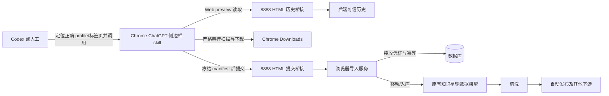

# 目标架构与修复方案

## 1. 目标

目标不是替换原有知识星球 API 同步方式，而是增加一个可靠的浏览器侧边栏上游，使它导入后与旧上游产生相同的系统数据，从而继续复用已有的入库、清洗、发布、音频转文字、视频编排等下游能力。

需要同时满足：

- 人可以在正确页面的 ChatGPT 侧边栏手动调用 skill；
- Codex 计划任务可以先定位正确 Chrome profile、窗口和标签页，再唤起同一个侧边栏 skill；
- 两种入口互不冲突，实际下载逻辑始终只有一套；
- 重试不会重复入库或重复创建 Celery 任务；
- 零文件也是一次正常同步，仍产生编排记录和通知；
- 失败时保留可审计信息，但不污染后续去重历史。

## 2. 职责边界



### Codex 或人工入口

- 人工入口：用户先打开准确标签页，再在同一 Chrome 窗口侧边栏发送一句 skill 调用。
- 计划任务入口：Codex 只做桥接预检、识别 `vimson5000` profile、复用现有 Chrome 窗口、定位/刷新目标标签页、打开侧边栏并发送一句调用。
- Codex 不直接扫描知识星球、不点击附件、不生成或提交 manifest。

### 侧边栏 skill

- 只使用当前附着的标签页；不自行创建浏览器上下文，不切换 profile/窗口/标签页，不导航或刷新。
- 通过 Web preview HTML 页读取历史与提交 manifest。
- 根据阈值、时间窗口、主题上限和下载上限完成业务扫描。
- 负责浏览器下载，并确认真实完成事件、路径和文件名。

### 8888 HTML 桥接

这是为侧边栏浏览器能力提供的同源网页入口，避免直接访问 5001 被浏览器策略阻断：

- 健康页：`http://localhost:8888/zsxq-sidebar-bridge.html`
- MP3 历史页：`http://localhost:8888/zsxq-sidebar-history.html?kind=mp3`
- PDF 历史页：`http://localhost:8888/zsxq-sidebar-history.html?kind=pdf`
- MP3 提交页：`http://localhost:8888/zsxq-sidebar-submit.html?kind=mp3`
- PDF 提交页：`http://localhost:8888/zsxq-sidebar-submit.html?kind=pdf`

侧边栏不得改用 curl、终端、`exec_command`、直接端口 5001 或 Downloads 中的历史 JSON。

### 后端

- 返回规范化、完整性明确的三日历史。
- 对新式 manifest 查询数据库接收凭证，过滤失败孤儿文件。
- 在预留 run_id 前完成确定性校验。
- 以 run_id/幂等键保证同一冻结 manifest 重放不产生第二个任务。
- 完成文件入库后，进入既有清洗和发布编排。

## 3. 历史去重契约

在固定媒体类型、group_id、tab_id 和最近 3 个自然日范围内，主去重键是：

```text
normalized_filename
```

规范化规则：

1. Unicode NFKC；
2. 删除不可见字符；
3. 折叠多余空白；
4. 拉丁字母不区分大小写；
5. 移除扩展名前 Chrome 自动生成的 ` (1)`、` (2)` 等后缀。

`published_at_canonical` 只用于审计，不参与拆分身份。`source_url` 不参与去重，因为已观察到同一文件 URL 序列化不稳定。只有缺失有效文件名时才退化使用 file_id 或 SHA-256。

历史接口返回：

- `normalized_filename`
- `published_at_canonical`
- `dedupe_key`
- `summary.trusted_source_files`
- `summary.ignored_untrusted_manifests`
- `complete`

当后端无法核验数据库接收凭证时，历史接口必须 fail closed：`complete=false`，skill 不得盲目下载。

## 4. 可信 manifest 契约

旧格式历史文件为兼容性继续读取。文件名末尾含 12 位十六进制摘要的新式确定性 manifest，只有数据库 `ZsxqBrowserSubmission.manifest_path` 中存在完全匹配路径时才可信。

因此：

- 后端已接受的 manifest 会进入后续去重；
- 校验失败但残留在 inbox 的孤儿 manifest 会被忽略；
- inbox 文件本身不再等价于“已入库”。

## 5. 候选到落盘文件的绑定状态机

每个候选必须依次通过：

```text
主题卡片 expected filename
  → 当前详情弹层 filename
  → 下载次数与按钮
  → 唯一下载完成事件
  → actual absolute_path / basename
  → manifest entry
```

关键规则：

1. 本轮维护 `seen_candidate_keys`，候选重复则不再打开弹层。
2. 预期名和弹层名第一次缺失/不一致时，保持同一弹层等待至少 2 秒，再读一次。
3. 第二次仍不一致，记录 `detail_file_mismatch_after_2s`，不点击下载。
4. 同时最多一个下载在途；当前候选未获得唯一完成事件前，不处理下一个候选。
5. 真实文件名规范化后必须等于预期名，否则记录 `downloaded_file_mismatch`，排除该条并停止后续下载点击。
6. 本轮维护 `downloaded_actual_base_names`；同一实际基名再次出现时记录 `duplicate_actual_file_in_same_run`，排除并停止后续下载点击。
7. 已停止下载后，已经验证成功的条目仍可组成 manifest 提交，但不得补扫或补下载。

## 6. manifest 与幂等契约

提交前必须满足：

- `scan_summary.new_download_success == len(files)`；
- `filename == basename(absolute_path)`，按同一规则规范化后仍相等；
- 所有规范化实际基名唯一；
- 文件内容 SHA-256 不重复；
- 每个本地文件存在且位于允许的 Downloads 范围；
- 每条记录已经通过候选、弹层、真实文件三方绑定。

完成自检后 manifest 被视为冻结对象。第一次提交后不能增删改字段。

重试规则：

- 明确 4xx/校验失败：本轮失败，不用同一个 run_id 提交修改后的 manifest。
- 结果未知：只允许同一 run_id、完全相同的 manifest 重放一次。
- 后端收到完全相同的重放，返回原 task_id，并标记 `replayed=true`，不得再次派发。

## 7. 当前参数与不可变项

| 项目 | MP3 | PDF |
| --- | ---: | ---: |
| 正式回溯窗口 | 48 小时 | 48 小时 |
| 正式最大主题组 | 40 | 40 |
| 正式最大下载数 | 40 | 40 |
| 临时测试参数 | 24/10/5 | 24/10/5 |
| 下载阈值 | 严格大于 10 | 严格大于 30 |
| 历史窗口 | 最近 3 个自然日 | 最近 3 个自然日 |

阈值和三日历史窗口不在本轮临时参数调整范围内。
