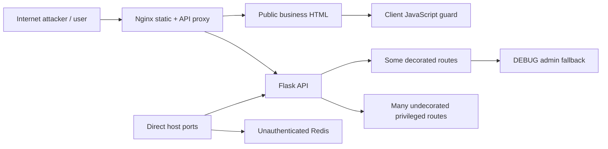
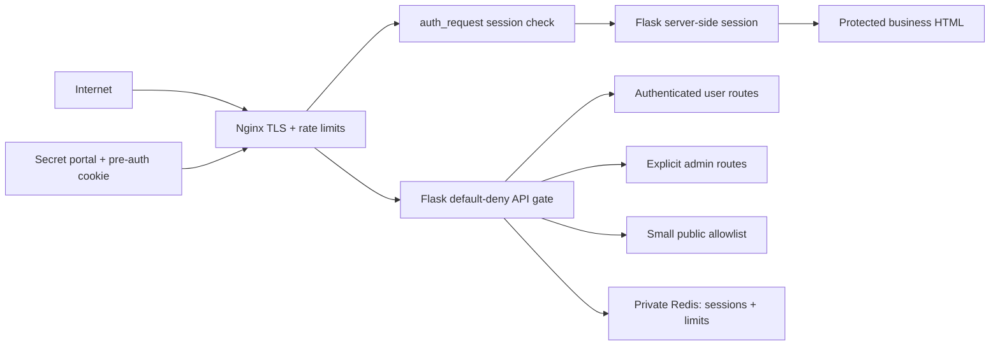
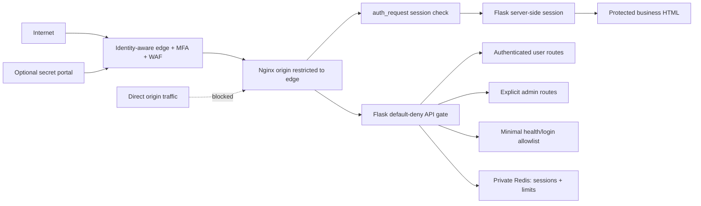

# Security Hardening Proposal: Centralize Public Authentication Enforcement

## Decision

We need one default-deny authorization boundary for every business page and API,
and we need to decide whether that boundary is owned only by our origin or is
preceded by an identity-aware edge with MFA.

## Executive Recommendation

The complete choice is **Option 1: Application and Nginx session gate** or
**Option 2: Identity-aware edge plus application gate**. I recommend Option 2 for
a public deployment containing provider credentials, publishing functions, and
process-control endpoints. Option 1 remains the required application baseline;
the edge does not excuse missing origin authorization.

## Evidence

| Evidence | Finding or document | What it establishes |
| --- | --- | --- |
| `E003` | Client-only page guard | Business HTML is served before a JavaScript redirect and remains retrievable without authentication. |
| `E004` | Missing API authorization | 225 of 371 statically inventoried handlers lacked a known auth decorator, including privileged writes. |
| `E005` | DEBUG administrator fallback | Anonymous decorated requests can become administrator requests under the active development configuration. |
| `E006` | Login abuse controls absent | Public login and registration have no effective throttling, lockout, or MFA. |
| `E007` | Browser bearer-token exposure | Long-lived JWTs are stored in `localStorage` and are not revoked on password change. |
| `E008` | Origin and Redis bypass exposure | Published host ports can bypass the reverse proxy and expose Redis. |
| `E010` | Proxy and CORS trust drift | Caller-controlled forwarding headers and wildcard credentialed CORS undermine identity and origin assumptions. |

I inspected both route registration and representative high-authority handlers.
The platform-credential and process-control routes make the impact concrete: this
is not merely a page-privacy gap. It is a missing authorization control owner.

## Current Design And Failure Mode

Nginx serves HTML directly. Browser JavaScript checks a bearer token after page
load, while Flask routes independently opt into decorators. Some routes have no
decorator; some decorated routes deliberately bypass identity in DEBUG. Docker can
publish Flask and Redis beside Nginx. An attacker therefore has multiple ways to
avoid the visible login flow.

Hiding a URL does not change this graph. The login API remains callable, redirects
reveal the path, and distributed credential stuffing can evade a single IP limit.
We can use an unlinked portal only to reduce automated noise after the enforcement
boundary is fixed.

## Desired Invariants

- Every HTTP business page and API request is denied unless it matches a reviewed
  public allowlist or carries a valid, revocable server-side session.
- Privileged capabilities—credentials, publishing, worker/process control,
  scheduling, logs, and account administration—require an administrator decision
  in addition to authentication.
- Production startup fails closed for DEBUG, development config, default/weak
  signing keys, wildcard credentialed CORS, or publicly bound internal services.
- The browser never stores authentication credentials in Web Storage.
- Login abuse is constrained by independent IP, normalized-account, and global
  limits, with progressive temporary lockout and MFA.
- Local automated `file://` rendering remains local and cannot create an HTTP
  bypass.

## Constraints And Non-Goals

- Public reachability is required, so a VPN-only design is not developed as a main
  option. It would be preferable if that requirement changes.
- Existing browser code expects bearer headers; migrating to cookie sessions and
  CSRF protection needs staged compatibility work.
- The login slug is not a password and does not count as an authentication factor.
- Health checks may remain public but must reveal minimal information and be
  separately rate-limited.

## Before Architecture

The current design has several parallel paths around authentication.

Source: [before diagram](../diagrams/centralize-authentication-enforcement-before.mmd).

## Options

### Option 1: Application And Nginx Session Gate

We make Flask default-deny with a small named allowlist and explicit administrator
route metadata. Browser authentication moves from `localStorage` JWTs to a
server-side Redis session using a `__Host-` cookie with `Secure`, `HttpOnly`, and
`SameSite` attributes. Nginx uses `auth_request` to validate the same session before
serving business HTML. Redis and Flask bind only to a private network or loopback.

Login uses shared Redis-backed limits with separate buckets for trusted client IP,
normalized account identifier, and global abuse. Public registration is disabled;
accounts are invitation or administrator provisioned. State-changing cookie-auth
requests receive CSRF protection. Password change and account disable revoke all
sessions.

An optional random portal path can return the login shell and issue a short-lived,
signed pre-auth cookie; `/login.html` and unauthenticated business routes return a
generic 404 without redirecting to the portal. This makes generic scanners work
harder without pretending the path is secret. If it leaks, the real controls still
hold.

Source: [Option 1 diagram](../diagrams/centralize-authentication-enforcement-app-gate-after.mmd).

| Change | Before | After | Security consequence | Cost |
| --- | --- | --- | --- | --- |
| Page access | Client redirect | Nginx auth subrequest | HTML cannot be fetched anonymously | Auth subrequest and cache design |
| API access | Decorator opt-in | Application default-deny | New routes fail closed | Allowlist and role inventory |
| Browser credential | JWT in Web Storage | Revocable HttpOnly session | Narrows XSS token theft and enables revocation | Frontend/CSRF migration |
| Abuse defense | None active | IP + account + global limits, lockout | Constrains brute force and spraying | Redis availability and tuning |
| Portal | Predictable page/redirect | Optional unlinked pre-auth path | Reduces noise only | Secret distribution and leakage handling |
| Internal ports | Host-published | Private network/loopback | Removes proxy bypass | Deployment change |

The performance cost is one authorization decision for HTML and one session lookup
per protected API request. We should cache only safe positive auth subrequests for
a very short period, never beyond revocation requirements. Rollback can return to
bearer compatibility while retaining default-deny and private ports.

### Option 2: Identity-Aware Edge Plus Application Gate

This option preserves all of Option 1 and adds an identity-aware proxy such as
Cloudflare Access, Authentik, or Authelia before Nginx. The edge requires MFA,
applies bot/WAF controls, and passes a signed identity assertion. The origin firewall
accepts only the edge/tunnel and administrative network, so the provider header can
be trusted only after signature/audience validation. Application sessions still
own fine-grained roles and dangerous operations.

The strongest case is containment: most password attacks stop before they consume
origin capacity, MFA protects even if an application password is reused, and the
origin ceases to be a parallel public entrance. The concern is availability and
operational dependency. An edge outage or policy mistake can lock out operators.
We need a tested break-glass route restricted to a private administrative network,
not a publicly reachable bypass.

Source: [Option 2 diagram](../diagrams/centralize-authentication-enforcement-edge-and-app-gate-after.mmd).

| Change | Before | After | Security consequence | Cost |
| --- | --- | --- | --- | --- |
| Internet identity | Application password only | Edge MFA plus app authorization | Strong resistance to password compromise | Provider/user enrollment |
| Origin reachability | Direct/public paths | Edge/tunnel allowlist | Removes direct bypass | Firewall and certificate lifecycle |
| Bot control | Origin only | Edge plus origin limits | Absorbs scans and distributed abuse earlier | Policy tuning and possible provider cost |
| Failure domain | Origin | Edge and origin | Better attack isolation, new dependency | Break-glass and outage runbook |

Rollback removes the edge routing only after re-enabling a reviewed direct TLS path;
the application gate and private Redis remain non-negotiable.

## Comparison

| Dimension | Option 1 | Option 2 |
| --- | --- | --- |
| Security | Strong default-deny origin, residual direct DDoS/credential pressure | Strongest: MFA and origin isolation plus origin controls |
| Performance | Session/auth-request lookup; source-derived | Adds edge network hop; usually cacheable but unmeasured |
| Memory | Redis session/rate-limit state | Same plus negligible edge metadata at origin |
| Reliability | Redis and origin are critical | Adds identity-provider/edge dependency but improves attack isolation |
| Operability | Nginx, Redis, session, CSRF, lockout ownership | Same plus edge policy, enrollment, tunnel/firewall, break-glass |
| Migration | Significant browser/API migration | Same migration plus DNS/network/provider rollout |

Before rollout, measure login latency, p50/p95 API overhead, Redis memory per active
session, auth subrequest rate, edge-to-origin latency, and behavior during Redis and
edge outages. Security must fail closed; availability thresholds should be selected
from actual operator needs rather than invented here.

## Recommendation

I recommend Option 2 because the application controls third-party credentials and
server processes. Option 1 becomes preferable if an external identity dependency is
unacceptable, but only after origin exposure, rate limiting, and MFA are solved by
equivalent self-hosted controls. A VPN-only boundary becomes preferable if public
reachability is no longer required.

## Evidence Coverage And Residual Risk

| Evidence | Option 1 | Option 2 | Tactical fix still required |
| --- | --- | --- | --- |
| `E003` — Client-only page guard | Addresses via Nginx session check | Addresses | Yes: keep client guard only for UX |
| `E004` — Missing API authorization | Addresses via default-deny and admin routes | Addresses | Yes: classify dangerous endpoints |
| `E005` — DEBUG administrator fallback | Addresses by removal/startup refusal | Addresses | Yes: remove fallback immediately |
| `E006` — Login abuse controls | Addresses at origin | Addresses at edge and origin | Yes: disable registration and add limits/MFA |
| `E007` — Browser bearer exposure | Addresses via server session | Addresses | Yes: revoke old JWTs during migration |
| `E008` — Origin/Redis bypass | Addresses via private binds | Addresses plus edge allowlist | Yes: firewall and Compose changes |
| `E010` — Proxy/CORS trust drift | Addresses with trusted proxy and same-origin | Addresses with signed edge identity | Yes: reject spoofed headers |

Residual risk includes application vulnerabilities reachable after valid login,
stolen operator devices, edge administrator compromise, and authorization mistakes
inside business-resource ownership. MFA, least privilege, endpoint tests, and audit
logs remain necessary.

## Migration And Rollout

First remove DEBUG bypass and close direct ports behind a maintenance boundary.
Introduce server sessions and dual-read compatibility, migrate the frontend, add
CSRF, then disable browser bearer issuance. Add the global gate in report-only test
inventory first, then enforce it with an explicit allowlist. Roll out Nginx page
auth, followed by the edge in observe mode, MFA enrollment, origin allowlisting,
and final enforcement.

## Validation Plan

- Automated route contract: anonymous requests receive 401/404 except the exact
  allowlist; normal users receive 403 on every administrator capability.
- Request every HTML file directly with JavaScript disabled and no cookie; none of
  the business documents may be returned.
- Attempt direct backend and Redis connections from the public network; both fail.
- Verify DEBUG/development/default-key production startup fails.
- Exercise per-IP, per-account, distributed, and global login limits; verify generic
  responses and temporary recovery without permanent denial of service.
- Verify XSS cannot read the session credential, CSRF is rejected, password change
  revokes sessions, and logout clears browser state.
- Validate edge assertion signature/audience and prove spoofed headers sent directly
  to origin cannot authorize.

## Implementation Work Packages

- Production fail-closed configuration and network closure.
- Central API authorization policy and administrator endpoint classification.
- Redis server-side session, secure cookies, CSRF, and JWT migration.
- Login/register/password policy, abuse limits, MFA, and optional pre-auth portal.
- Nginx `auth_request`, no-index headers, protected static HTML, and cache policy.
- Identity-aware edge, origin restriction, and break-glass runbook.
- Route inventory and adversarial authentication test suite.

## Open Questions

- Which identity-aware edge and MFA method should we use?
- Which business APIs need service-to-service tokens rather than browser sessions?
- What session lifetime and operator outage tolerance are acceptable?
- Should the optional portal slug be used, knowing it is only a noise-reduction
  control?
