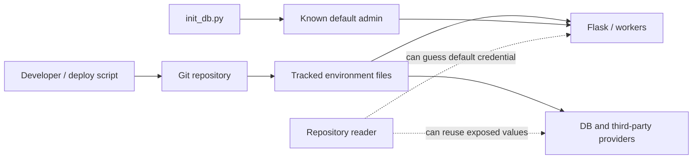
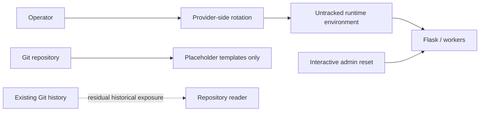
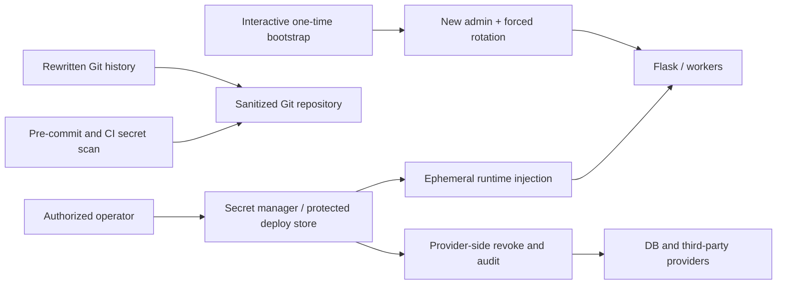

# Security Hardening Proposal: Contain Exposed Credentials

## Decision

We need to choose whether to perform only the urgent rotation or establish an
owned secret lifecycle that also removes historical exposure and prevents the
same failure from recurring.

## Executive Recommendation

The complete choice is **Option 1: Rotate and remove current files** or
**Option 2: Managed secret lifecycle and history cleanup**. I recommend Option 2,
executed with Option 1's provider rotation as its first emergency work package.
The extra work is justified because the sensitive files exist in multiple Git
commits; editing HEAD cannot make their former values secret again.

## Evidence

| Evidence | Finding or document | What it establishes |
| --- | --- | --- |
| `E001` | Tracked production secrets | `.env.bak` and a deployment environment file contain non-placeholder credentials and cryptographic keys in Git history. |
| `E002` | Known default administrator credential | Initialization source publishes a fixed administrator credential, and the active administrator still matched the known default during a read-only check. |

I inspected the tracked-file state and commit history without printing any secret
value. The historical copies most influenced this diagnosis: we are dealing with
credential disclosure, not merely poor configuration hygiene.

## Current Design And Failure Mode

Deployment scripts and backup files make Git a carrier for runtime authority.
Anyone who has read an affected clone or commit may retain those values after we
delete the files. At the same time, database bootstrap creates predictable account
authority and the password-reset script accepts a password in a shell argument,
which can expose the replacement through history or a process listing.

The structural condition is that secret creation, storage, rotation, and delivery
have no single owner. Each script chooses its own transport. This makes a local
cleanup likely to drift again.

## Desired Invariants

- No deployable secret or credential appears in Git at any revision distributed
  after cleanup.
- Every value found in tracked secret-bearing files is revoked or rotated at its
  real authority provider before public launch.
- Administrator bootstrap is explicit, one-time, interactive, and never emits the
  password to logs, command arguments, or normal stdout.
- Password reset invalidates existing sessions and tokens.
- CI rejects new secret material before it reaches a shared branch.

## Constraints And Non-Goals

- Git history rewriting requires coordination with every clone and open branch.
- This proposal does not assume that deleting a key at one provider revokes copies
  at another; each provider needs an explicit confirmation receipt.
- We will not put replacement passwords into this repository or chat.

## Before Architecture

The current flow gives the repository ambient authority over production systems.

Source: [before diagram](../diagrams/contain-exposed-secrets-before.mmd).

## Options

### Option 1: Rotate And Remove Current Files

We rotate provider credentials, replace the administrator password, remove the
tracked files from the current tree, expand `.gitignore`, and convert deployment
configuration to placeholder templates. This is the fastest route to stopping use
of the known values. It preserves the existing environment-variable deployment
mechanism and is easy to roll back at the code level.

The problem is residual historical authority: old commits and existing clones
retain every former value. Rotation makes those copies useless only where we
successfully rotate, so missed providers remain exposed. There is also no automated
barrier against committing the replacements later.

Source: [Option 1 diagram](../diagrams/contain-exposed-secrets-rotate-and-remove-after.mmd).

| Change | Before | After | Security consequence | Cost |
| --- | --- | --- | --- | --- |
| Provider values | Known tracked values may remain valid | Each known value rotated | Stops reuse of values covered by the rotation inventory | Provider-by-provider coordination |
| Administrator | Predictable active account password | Interactive strong replacement | Removes immediate password compromise | Secure one-time delivery |
| Repository HEAD | Real environment files | Templates only | Prevents ordinary checkout exposure | Deployment configuration change |
| Git history | Contains former values | Still contains former values | Residual disclosure remains | None now; debt remains |

Rollback means restoring the deployment mechanism, never restoring revoked values.

### Option 2: Managed Secret Lifecycle And History Cleanup

This option begins with the same emergency rotation, then moves secrets to a
protected deployment store or secret manager, rewrites affected Git history, and
adds pre-commit/CI detection. Administrator bootstrap becomes an interactive
command using `getpass` or a mode-`0600` one-time input, creates a non-default
operator name, forces first-login rotation, and revokes older sessions.

The attractive part is that authority has an owner: the manager issues runtime
values, provider rotation has an auditable inventory, and Git becomes an invalid
transport. What gives me pause is history rewriting. Every collaborator must
discard or carefully rebase old clones, and stale forks can reintroduce the old
history. We should schedule a coordinated maintenance window and preserve a
restricted forensic bundle outside ordinary developer access if incident policy
requires it.

Source: [Option 2 diagram](../diagrams/contain-exposed-secrets-managed-secrets-after.mmd).

| Change | Before | After | Security consequence | Cost |
| --- | --- | --- | --- | --- |
| Secret transport | Git and ad-hoc environment files | Managed injection | Removes repository authority over production | Secret-store operation |
| History | Credentials remain in commits | Coordinated rewrite | Removes routine access to disclosed copies | Disruptive clone/branch migration |
| Prevention | Convention | CI and local secret scanning | Reduces recurrence | False-positive triage |
| Bootstrap | Fixed credential and CLI password argument | One-time interactive flow | Avoids predictable and process-list exposure | New deployment procedure |

Rollback can restore the prior deployment topology using newly generated values;
the repository must not be rolled back to secret-bearing commits.

## Comparison

| Dimension | Option 1 | Option 2 |
| --- | --- | --- |
| Security | Improves immediately but historical and recurrence risk remain | Strongest containment and recurrence reduction |
| Performance | Neutral; source-derived | Neutral; secret fetch occurs at deploy/start, not request path |
| Memory | Neutral | Neutral to negligible client overhead |
| Reliability | Depends on complete manual inventory | Adds secret-store dependency at deployment/start |
| Operability | Low initial burden, repeated manual rotation | Higher setup burden, clearer ownership and audit trail |
| Migration | Small current-tree change | Coordinated history rewrite and deployment migration |

No performance measurements are required for Option 1. For Option 2 we should test
startup with the secret store available/unavailable and define whether the service
fails closed without falling into a restart storm.

## Recommendation

I recommend Option 2 because `E001` spans history and multiple providers. Option 1
is acceptable only as the first incident-containment slice; it should not be marked
complete until history and recurrence controls have owners.

## Evidence Coverage And Residual Risk

| Evidence | Option 1 | Option 2 | Tactical fix still required |
| --- | --- | --- | --- |
| `E001` — Tracked production secrets | Mitigates through rotation | Addresses managed storage and routine history exposure | Yes: revoke every provider value |
| `E002` — Known default administrator | Addresses immediate password | Addresses bootstrap lifecycle | Yes: reset/deactivate current account before launch |

Residual risk remains in clones, backups, build caches, pasted logs, and provider
audit trails that history rewriting cannot reach. Provider-side revocation is the
decisive control.

## Migration And Rollout

Use a short incident register with owner, provider, rotation time, validation, and
revocation receipt. Rotate database and application signing secrets with an
explicit session invalidation window. After all values are dead, clean the files,
rewrite history, force-push in a coordinated window, and require fresh clones.

## Validation Plan

- Search current tree and all refs with a secret scanner; review every hit.
- Verify old provider values fail without placing them in test logs.
- Confirm a clean deployment receives secrets only from the selected store.
- Confirm bootstrap and reset processes do not expose passwords in shell history,
  process listings, stdout, application logs, or Git.
- Confirm all prior sessions fail after signing-key/password rotation.

## Implementation Work Packages

- Build and execute the credential rotation inventory.
- Replace fixed bootstrap and CLI password arguments.
- Migrate deployment secret injection and placeholder templates.
- Remove tracked secret files and rewrite Git history.
- Add pre-commit and CI secret scanning with a documented exception process.

## Open Questions

- Which secret manager or protected deployment store will be the authority?
- Who owns rotation for each third-party provider?
- Which non-admin accounts should remain active after the administrator reset?
- Is a restricted forensic archive required before rewriting history?
