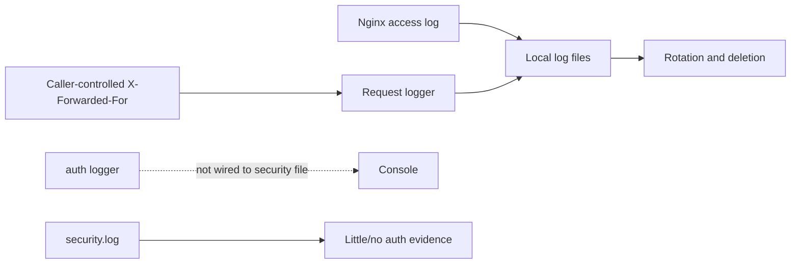
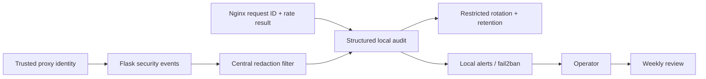
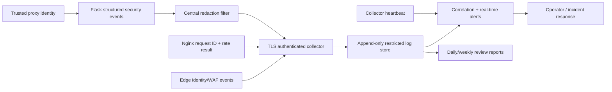

# Security Hardening Proposal: Establish Actionable Security Telemetry

## Decision

We need to choose whether corrected authentication events remain only on the host
or are forwarded to a restricted append-only system that can correlate and alert
while the attacker may control the application host.

## Executive Recommendation

The complete choice is **Option 1: Structured local security audit** or
**Option 2: Centralized append-only monitoring**. I recommend Option 2 for public
operation, built on Option 1's event schema and redaction. Central collection does
not help if the source events are incomplete or contain credentials.

## Evidence

| Evidence | Finding or document | What it establishes |
| --- | --- | --- |
| `E009` | Security log stream is not effective | Authentication and security loggers do not meet; failed logins are not audited, and the inspected security log was empty. |
| `E010` | Untrusted proxy identity and permissive request logging | Caller-controlled forwarding headers can forge client identity, while current redaction misses header, list, and secret-name variants. |
| `E004` | Privileged undecorated operations | Process control, credential changes, publishing, and scheduling need administrator audit events after authorization is added. |

I inspected the logger wiring and representative failure branches. The decisive
detail is not the existence of log rotation; it is that the event needed to detect
credential attacks is never emitted to the configured security stream.

## Current Design And Failure Mode

The request logger records paths and a caller-influenced IP. Authentication logs a
request and successful user, but invalid credentials return without a dedicated
failure event. A file named `security.log` exists, yet authentication writes to a
different logger. Local files are readable more broadly than necessary and can be
deleted by the same host that runs the application.

The structural condition is that logs are treated as diagnostic output rather
than a security event pipeline. There is no stable schema, trusted identity source,
integrity boundary, detection rule, or collection-health signal.

## Desired Invariants

- Every authentication success/failure, limit, lockout, MFA event, session revoke,
  password/reset event, account/role change, administrator action, credential
  change, process control, publish/delete, and 401/403 decision emits one structured
  event with a request ID.
- Client IP is derived only from a trusted proxy chain; the direct peer is retained.
- Passwords, authorization headers, cookies, JWTs, session IDs, API keys, database
  URLs, provider cookies, and request bodies for auth/credential endpoints never
  leave the process as logs.
- Security events are retained outside the application host with append-only,
  least-privilege access and collection-health alerts.
- Alerts are actionable; routine review complements, rather than replaces,
  patching, dependency scans, backups, and access review.

## Constraints And Non-Goals

- Retention must be chosen against privacy, capacity, and legal requirements; the
  proposal suggests ranges rather than declaring a compliance period.
- We will not use raw usernames as a high-cardinality public metric. Stable account
  IDs or keyed hashes are preferable for failed, unverified input.
- Logs are evidence and detection input, not an authorization mechanism.

## Before Architecture

The current streams do not form a trustworthy security narrative.

Source: [before diagram](../diagrams/establish-security-telemetry-before.mmd).

## Options

### Option 1: Structured Local Security Audit

We introduce one `security` JSON logger and a shared recursive redaction filter.
Nginx creates or propagates a request ID; Flask records the trusted client IP, proxy
peer, authenticated user ID, event, result, reason code, target resource, role, and
limit/lock state. Authentication and sensitive credential routes prohibit body
logging entirely. File permissions become `0640` or tighter under a dedicated
service group, with rotation by time and size.

Local detection can feed fail2ban and a lightweight alert job. This is relatively
easy to operate and remains useful when a central system is unavailable. The main
residual risk is integrity: an attacker who compromises the application account or
host may erase or alter the evidence before review.

Source: [Option 1 diagram](../diagrams/establish-security-telemetry-structured-local-after.mmd).

| Change | Before | After | Security consequence | Cost |
| --- | --- | --- | --- | --- |
| Auth events | Missing/inconsistent | Stable JSON events | Enables attack detection and investigation | Schema maintenance |
| IP identity | Raw forwarding header | Trusted proxy plus peer | Prevents simple log/limit spoofing | Proxy configuration |
| Sensitive data | Partial key matching | Central recursive/header/token redaction | Reduces secondary credential leakage | Tests and false-positive review |
| Files | Broad local diagnostic files | Restricted security stream | Narrows local disclosure | Service groups and rotation |

Rollback can disable new alert rules while preserving the event fields; reverting
redaction or failure events would recreate the evidence gap and is not acceptable.

### Option 2: Centralized Append-Only Monitoring

This option keeps the local schema and sends events over authenticated TLS to a
restricted collector and append-only store. Edge, Nginx, Flask, system, and worker
events share the request/user/action correlation fields. Detection rules alert on
distributed login failures, unusual successful administrator login, 401/403/429
bursts, new administrator or role changes, credential operations, process/queue
control, publishing/deletion, log-collector silence, disk pressure, certificate
expiry, and 5xx changes.

The attractive part is failure containment: the application cannot silently erase
the only record of its compromise, and distributed behavior can be correlated
across IPs and accounts. The operational cost is meaningful. The collector needs
authentication, encrypted transport, storage lifecycle, restricted query access,
and its own health alert; noisy rules can train operators to ignore the system.

Source: [Option 2 diagram](../diagrams/establish-security-telemetry-centralized-audit-after.mmd).

| Change | Before | After | Security consequence | Cost |
| --- | --- | --- | --- | --- |
| Integrity | Host-local, mutable | Restricted append-only copy | Preserves evidence after host compromise | External storage/identity operation |
| Detection | Manual file review | Correlation and real-time alerts | Shortens time to contain active attacks | Rule tuning and on-call ownership |
| Collection | No health contract | Heartbeats and backlog alerts | Detects silent telemetry loss | Additional monitoring path |
| Retention | Default local cleanup | Tiered policy | Supports investigation windows | Capacity and privacy governance |

Rollback can retain structured local events while disabling forwarding. We should
buffer bounded events during collector outages and never block core requests on a
remote log write.

## Comparison

| Dimension | Option 1 | Option 2 |
| --- | --- | --- |
| Security | Improves visibility; host compromise can erase evidence | Best integrity and cross-layer correlation |
| Performance | Small JSON/redaction CPU and local I/O | Same plus asynchronous transport; must be bounded |
| Memory | Small buffers | Bounded collector queue/spool required |
| Reliability | Independent of remote collector | New pipeline dependency; application must not block on it |
| Operability | Rotation, fail2ban, weekly review | Collector, TLS, storage, rules, on-call, privacy/access control |
| Migration | Focused logger and Nginx changes | Same schema plus transport and dashboard migration |

Benchmark request throughput with security logging on/off, queue depth under burst,
CPU spent in redaction, disk growth per day, collector lag, and drop behavior at the
configured queue bound. No measurements have yet been made.

## Recommendation

I recommend Option 2 once Option 1's source event quality is validated. The public
threat model and high-authority operations justify preserving evidence off-host.
Option 1 is proportionate for a short pre-launch stage or if central logging cannot
yet be operated reliably.

## Evidence Coverage And Residual Risk

| Evidence | Option 1 | Option 2 | Tactical fix still required |
| --- | --- | --- | --- |
| `E009` — Ineffective security stream | Addresses event production | Addresses event production, integrity, and alerting | Yes: wire auth failures before launch |
| `E010` — Proxy identity/redaction drift | Addresses locally | Addresses plus correlation | Yes: close direct origin and configure trusted proxy |
| `E004` — Privileged operations | Mitigates through audit | Mitigates with off-host detection | Yes: authorization still required |

Logs cannot prevent an authorized malicious action or replace least privilege.
Residual risks include missed event instrumentation, compromised collector admins,
alert fatigue, and secrets embedded inside arbitrary exception text.

## Migration And Rollout

Define and test the schema/redactor first. Add auth and administrator events, then
Nginx request IDs and trusted IP handling. Run local audit in shadow review, create
baseline volumes, and only then enable alert thresholds. Forward to the central
store in parallel, validate completeness and redaction, and establish retention and
access review before relying on it for incident response.

Suggested operating cadence is real-time alerts, daily automated summaries, weekly
security review, monthly patch/dependency/configuration review, and quarterly access
and restore exercises. Password changes should be event- or compromise-driven, not
forced periodically without cause.

## Validation Plan

- Generate success, invalid password, nonexistent account, rate limit, lockout,
  MFA, logout, reset, role, credential, process, and denial events; validate schema.
- Seed canary secrets/JWT/cookies in nested dict/list/header/error fixtures and prove
  no raw value reaches any sink.
- Send spoofed forwarding headers through direct and proxied paths; verify trusted
  client IP and proxy peer are correct.
- Stop the collector, fill the bounded queue, restore it, and verify no request hang,
  controlled drops, and an explicit telemetry-loss alert.
- Compare Nginx, Flask, edge, and store counts for a known request corpus.

## Implementation Work Packages

- Security event schema, central redactor, and unit/property tests.
- Trusted proxy/request ID propagation and direct-origin closure.
- Authentication, authorization, and administrator action instrumentation.
- Restricted local file handlers, rotation, retention, and disk alerts.
- Authenticated TLS collector, append-only storage, dashboards, and alert rules.
- Review/runbook ownership and periodic control checks.

## Open Questions

- Which central store and alert destination will be operated?
- What security-log retention is appropriate (a 180–365 day range is a starting
  design input, not a compliance conclusion)?
- Who is on call for authentication and administrator-operation alerts?
- Which fields need pseudonymization for privacy requirements?
