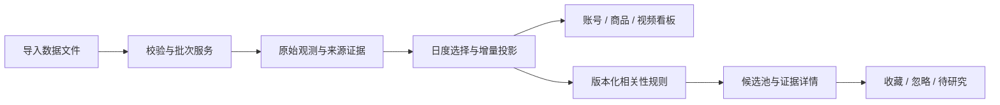

# 视频号图书带货情报模块：架构设计

状态：架构决策记录。用户随后授权实施；截至 2026-11-18，功能、当前库独立迁移和运行入口均已完成。本文保留设计阶段的决策依据，不能当作“尚未实施”状态。

初稿：2026-11-17；范围修订：2026-11-18（Asia/Shanghai）。用户先要求完成设计后停下，随后另行要求继续实现；当前实现细节与验收状态见[实现计划](../plans/2026-11-18-book-commerce.md)和[迁移记录](../../operations/book-commerce/migration.md)。本文中的起始阈值仍属于可由管理员调整的规则配置，不是统计验证后的因果结论。

配套文档：[实现规范与验收标准](2026-11-17-book-commerce-standards.md)及[导入 JSON 约定](../../operations/book-commerce/import-contract.md)。外部数据合同只规定交付文件，不包含采集器实现或对外自动连接。

## 1. 业务目标和边界

建立“数据导入 → 历史保存 → 账号/商品/视频浏览与增长榜 → 有证据的候选池 → 收藏、忽略、待研究”的内部闭环。

业务问题：哪些账号值得关注、哪些商品在增长、哪些视频互动起量、哪些视频与商品增长同时出现且值得拆解。系统提供观测与相关性线索，不声称掌握实际成交归因。

用户已确认第一版只包含：数据导入（校验、去重、关联、历史保存与结果反馈）、账号概览、商品/视频增长榜、规则候选池和人工决策（收藏、忽略、待研究）。

不提供纠错、数据手填、主数据编辑后台、二创稿编辑或工作流交接、自动采集、自动二创、自动发布、订单分析、跨平台改造。上述功能不是待开发的后续里程碑，本设计不为它们预留接口或表。

导入是业务数据唯一写入入口。内部批量写入服务就是导入背后的校验、关联、事务保存逻辑，不是另一项用户功能。导入失败返回行号、字段路径和原因；拒绝不合格批次，不提供页面修复或覆盖既有事实入口。内部规范先用合成数据验证；外部采集方 JSON 交付格式后续再约定。

## 2. 已核实的现状

| 位置 | 发现 | 设计影响 |
|---|---|---|
| `src/backend/models/channel.py`、`video.py`、`channel_data.py` | 用户所属的 YouTube 频道和视频；视频序列化生成 YouTube URL，频道带 CPM，历史表有浏览和收入含义 | 不把视频号对象塞进现有 `channels/videos`；不复用旧增量字段的口径 |
| `src/backend/models/bilibili_intelligence.py` | B站独立对标实体、视频、按日充电快照、匹配/决策状态 | 借鉴业务分域组织，不引用 B站专用字段及采集器 |
| `src/backend/apis/v1/zsxq_json_import.py`、对应 service | 已有预览、校验、提交、回滚、历史查询模式 | 复用交互和事务原则；不耦合星球的解析器与运行表 |
| `src/backend/models/__init__.py`、`migrations/env.py` | Flask-SQLAlchemy 与 Alembic/Flask-Migrate | 沿用模型和迁移体系，不引入另一套 ORM |
| `src/backend/utils/auth_utils.py` | `require_login`、`require_admin` | 新接口沿用认证，数据访问规则另行显式限定 |
| `src/frontend/js/shared-navigation.js` | 静态 HTML/JS 页面及共享导航 | 新增“图书带货情报”入口，不引入 React/Vite 架构迁移 |

2026-11-17 通过当前配置连接数据库，仅做 schema/版本读取；连接设置了 PostgreSQL 只读事务和 5 秒语句超时，未读取账号业务记录，未写入数据库：

- 当前配置实际连接 PostgreSQL；不是依据文件名猜测 SQLite。
- 仓库迁移头：`20261110_feature_heads_merge`、`20261110_voyage_ratings`。
- 数据库 `alembic_version`：`20261112_upower_topics`；本地 `src/backend/migrations` 未找到对应 revision。
- 已存在 YouTube、B站情报、充电快照、PublicationTask 等相关表；当前默认 schema 的表清单中未发现商品/橱窗/带货观测域表。
- 这是“当前连接”的证据，不代表其他部署或 schema。实施前必须重新核实。
- `.venv` 缺少 Alembic；现有 `venv -> venv-3.11` 可加载 SQLAlchemy/Alembic/psycopg2。后续检查使用经验证的运行环境，不盲目安装或替换依赖。

## 3. 架构选择

| 方案 | 收益 | 代价和结论 |
|---|---|---|
| 扩展 YouTube 表为统一平台模型 | 表面上表少 | 会改 URL、唯一键、采集器、CPM、关联和所有查询；为当前业务承担不必要回归，不采用 |
| 在现有 Flask 应用内新增带货业务域 | 独立语义，复用数据库/认证/导航/任务基础设施；便于增量上线 | 需要新模型与服务；推荐 |
| 单独建立服务/数据库或 Supabase 应用 | 部署隔离 | 重复认证和运维，需要跨系统交接，当前无必要，不采用 |

选型建议：模块名 `book_commerce`，表前缀 `bc_`，API `/api/v1/book-commerce`，平台值沿用现有 `wechat_channels`。第一版只接受此平台；保留平台列用于身份命名空间，不承诺多平台产品。

主运行目标为当前 PostgreSQL。核心字段使用可移植的 SQLAlchemy 类型，在 SQLite 做快速服务测试；不承诺 MySQL、Supabase/PostgREST 已兼容。PostgREST 不作为绕过领域校验的直接写入口。

模块共享情报数据：管理员导入数据和运行分析，登录用户读取共享情报；收藏、忽略、待研究按 owner 隔离。权限细分为架构默认值；人工决策不修改机器结论或原始数据。

## 4. 数据模型

### 4.1 通用约定

- 新主键为应用生成的 UUID 字符串 `VARCHAR(36)`，沿用情报和任务域风格；不得把名称、日期拼接为主键。
- 外部标识使用不透明字符串 `VARCHAR(255)`；平台 ID 与库内 UUID 分离。有平台ID时可在内部以平台ID规范化生成source_key；没有平台 ID 时必须提供来源命名空间内稳定的 source_key，用 `(source, source_key)` 匹配；不能仅靠名称或每批随机 ID 建实体。缺少两种稳定标识时拒绝该批次，不要求人工选实体。
- 时间存 UTC，沿用现有 naive UTC 列习惯；API 输出带 `Z` 的 ISO 8601。业务日期按 `Asia/Shanghai` 推导，不能用入库日期代替观测日期。
- 金额 `NUMERIC(12,2)`，接口使用十进制字符串和 `currency=CNY`；计数 `BIGINT`，原始累计数不得为负。
- 不知道用 NULL；0 仅表示明确观测为零。布尔值允许未知时为 NULL。缺失字段和显式清空不是同义词。
- 主数据有 `created_at/updated_at`、`last_observed_at`；其描述字段只由更新时刻的导入数据更新。个人决策使用整型 version 防止并发覆盖。
- 不提供主数据删除、停用或纠错操作。观测及推导依据不可级联清空，FK 默认 RESTRICT；导入文件未出现某实体不代表删除或下架。
- 高价值身份、范围、关联、时间、状态必须有类型列与约束；JSON 仅承载原始证据、指标质量和规则结果，不能替代核心 FK。

### 4.2 主数据与关系（8 张）

| 表 | 主要字段 | 唯一键 / 语义 |
|---|---|---|
| `bc_accounts` | platform、external_id 可空、source、source_key、name、category（来源原文兼容字段）、bio、location、is_ai_content、source_url | `(platform, external_id)` 非空时唯一；昵称不唯一；赛道筛选不读此文本列 |
| `bc_categories` | parent_id、name、path、created_at | `path` 唯一；将斜杠路径拆成可逐级选择的赛道节点 |
| `bc_account_categories` | account_id、category_id | 账号与赛道多对多关系；账号只关联所选路径的末级节点 |
| `bc_books` | source、source_key、isbn13 可空、title、author、publisher、edition、category | isbn13 非空时唯一，代表具体版本；书名不唯一；合集不强行绑定单本书 |
| `bc_listings` | platform、external_id 可空、source、source_key、shop_external_id、shop_name、book_id 可空、title、variant、source_url | `(platform, external_id)` 非空时唯一，定义为平台可比较销量的商品单元；书籍只是可选归类 |
| `bc_account_listings` | account_id、listing_id、first_seen_at、last_seen_at、status | `(account_id, listing_id)` 唯一，记录账号橱窗出现过的商品；status=`active/inactive/unknown` |
| `bc_videos` | account_id、platform、external_id 可空、source、source_key、title、published_at 可空、source_url、core_hook、script_text、transcript_status、transcript_source、transcript_updated_at | `(platform, external_id)` 非空时唯一；同一外部视频不允许变更归属账号 |
| `bc_video_listing_links` | video_id、account_listing_id、valid_from、valid_to 可空、relation_type、verification_status、evidence_reference、observed_at | 一条视频允许多商品，保存挂载关系有效期；禁止不同账号之间建立链接 |

链接的 `relation_type=attached/mentioned`；`verification_status=confirmed/unverified/rejected`。第一版推荐仅使用 confirmed attached。只有标题提到书名、语义相近或同一本书的另一个店铺链接均不算明确挂载。

账号赛道采用 `bc_categories` + `bc_account_categories` 关系建模。导入兼容旧字段 `category: "一级 / 二级 / 三级"`，也支持 `categories: ["一级 / 二级 / 三级", "另一条赛道"]`；斜杠路径拆为父子节点，关联表只保存每条路径的末级节点。页面允许搜索并多选赛道，选择多项按 OR 处理；选择父级节点会包含该节点下的子级赛道。旧 `bc_accounts.category` 只保留来源原文兼容，不再参与筛选和展示。

挂载历史采用半开区间 `[valid_from, valid_to)`，同一 video/account_listing 的有效记录不得重叠；PostgreSQL 在服务锁定该 video 后校验并写入。SQLite 仅用于功能测试，不承担生产并发保证。valid_from 必须有证据；只知道当前挂载时取当前观测时间，不能自动回填为发布时间。

`is_pinned` 是时变属性，放在视频观测中，详情可展示最近一次值。售价也是时变属性，放在商品观测中；出版社与店铺分别保存，不能混作 publisher。

### 4.3 原始事实与计算结果（6 张）

| 表 | 内容 | 约束 |
|---|---|---|
| `bc_ingest_batches` | source、adapter_version、idempotency_key、payload_hash、actor_user_id、received_at、status、error_summary、counts | `(source, idempotency_key)` 唯一；状态 accepted/committed/rejected/failed；预览不创建业务事实 |
| `bc_observations` | batch_id、kind、account_id、account_listing_id 可空、video_id 可空、observed_at、business_date、metric_scope、series_key、values JSON、quality JSON、raw_evidence JSON、content_hash、received_at | 三种 kind：account/showcase/video；CHECK 约束正确目标组合；内容去重键与观测时点唯一键；不可覆盖 |
| `bc_daily_metrics` | kind、目标 FK、business_date、series_key、generation_id、selected_observation_id、previous_observation_id、current_values JSON、deltas JSON、quality JSON、window_start/end、calculation_version | 每实体/业务日/series/generation 一条；NULL 目标不用于简单 nullable 复合唯一键，使用明确非空 `target_key` 辅助唯一约束 |
| `bc_analysis_runs` | 日期范围、状态、input_revision、rules_version、rules_config JSON、calculation_version、requested_by、started_at/completed_at、error_code | pending/running/completed/failed；一个 run 的投影与推荐共同发布 |
| `bc_recommendations` | run_id、account_id、account_listing_id、video_id、business_date、status、reason_codes、evidence JSON、sales_delta、shares_delta、window_start/end、rule_version | `(run_id, video_id, account_listing_id, business_date)` 唯一；状态 candidate/insufficient/anomaly |
| `bc_state` | 单例主键、input_revision、published_run_id、active_rules_version、rules_config JSON、updated_at | 协调输入变更和投影发布；所有输入写入串行锁定此行，先满足单工作台规模 |

`target_key` 由服务根据 kind 与目标 UUID 固定生成，客户端不可写；目标 FK 仍为实际约束。`series_key` 标识来源的连续统计口径，由来源、范围、计数口径版本构成，不含批次 ID。不能把不同 series 的快照相减。

把三类观测放在一张受约束的事实表，是为了共享不可变证据和批次追踪。业务查询读日度投影而不是扫描任意 JSON。`sales_delta/shares_delta` 等参与排序的投影字段另外设 BIGINT 类型列；JSON 存完整细节。第一版不建设通用时序平台。

指标字典：

| kind | values 白名单 | 说明 |
|---|---|---|
| account | total_posts、showcase_rating、buyers_count、total_sales、repeat_customers、total_products | rating 0–5；其余非负整数；账号总销量单独显示，不与商品销量求和对账 |
| showcase | cumulative_sales、price、currency、availability | scope=`account_listing/platform_listing/unknown`；只有 account_listing 可用于本账号关联分析 |
| video | likes、shares、comments、is_pinned | 不具备播放量时不把互动数命名为“流量”；不发明播放量 |

quality 对每个指标记录 `exact/rounded/lower_bound/unknown`、原始展示文本。`1.2万`、`1万+` 仅保留原文与质量，不能假装精确为 12000/10000 参与增量。未来加入区间估计需另设算法版本。

同一个平台商品可能出现在多个账号橱窗。平台商品总销量存 `platform_listing` 范围，仍保留观察入口，但聚合时按 listing+series 去重；不能复制成每个账号的销量。范围不明确默认 unknown。

### 4.4 人工决策（1 张）

| 表 | 主要字段 | 约定 |
|---|---|---|
| `bc_candidate_decisions` | owner_user_id、video_id、account_listing_id、business_date、decision、note、version、evidence_run_id、created_at、updated_at | `(owner_user_id,video_id,account_listing_id,business_date)` 唯一；pending/saved/dismissed/to_research；机器重算不得覆盖人工状态 |

pending=尚未处理，saved=收藏，dismissed=忽略，to_research=待研究。四者互斥，可改标或恢复 pending；备注可选，不是文案编辑器。收藏与待研究默认显示，忽略默认隐藏但可筛选查看。decision 是个人判断，不表示真实成交、任务执行或生产进度。

决策通过逻辑候选键跨 run 保留，evidence_run_id 记录用户当时看到的证据版本。重算覆盖该日期且候选不再出现时，个人记录仍可访问，并标记“当前规则下未入选”；当前run未覆盖该日期时标记“该日期未重新计算”；不能删除或自动改掉用户标记。

本设计共 15 张新表：主数据关系 8 张、事实与计算 6 张、人工决策 1 张。不包含草稿、工作流链接、订单或纠错事件表。

## 5. 导入事实、日度选择与增量

### 5.1 导入与冲突处理

1. 校验操作者、大小、字段类型、稳定标识、引用关系和来源口径；未知字段报字段路径错误，不静默吞掉。
2. 预览显示新增实体、描述更新、新增观测、重复、冲突和失败；不改变业务数据。提交重验 payload_hash 与预期 input_revision。
3. 一批最多 1000 条观测或 5 MiB；整批事务。可在同一批中先建账号/书籍/商品/视频，再解引用保存关联与观测；引用必须能从本批或已有库解析。
4. 主数据描述变化（如改名、简介）是新时刻的来源信息，不是纠错：按明确的 observed_at 更新最新展示，保留批次中的原始内容；较早补录不得覆盖最新描述。同一时刻内容冲突拒绝。缺失字段不清空旧值；第一版不支持显式清空。平台身份、视频归属账号、已确认的书籍版本映射不可被导入重写，冲突拒绝；此前未知的映射可按证据补全。
5. 已成功的同 key 同 hash 请求优先返回已有结果；同 key 不同 hash 返回409。content_hash 涵盖目标、时点、来源、口径、指标和质量等规范内容，排除 batch_id/received_at/采集入口等传输信息；跨批重复不增加事实。
6. 相同 target_key/series_key/observed_at 的不同值为冲突，拒绝整个批次，不覆盖、不修正、不作废旧记录。新时刻的不同计数是新观测，允许追加；历史缺失时点允许补录。
7. 新事实、主数据有效更新、关系扩展或规则变化增加 input_revision；全重复批次不使投影失效。批次记录引用已存在事实以便追溯。
8. 不提供已入库数据纠错能力，包括更正接口、覆盖导入、撤销批次。若真实数据以后出现无法接受的错误，需要另行评审处理；不能假借补录篡改采集时间。

### 5.2 日度投影

- 每实体、series、业务日选择 observed_at 最晚的一条；相同时间不容许冲突事实同时生效。
- 按整条观测选取，不把上午点赞与晚上转发混成一条。晚间缺失某指标时该指标为 unknown；可显示上次已知值，但必须附独立时间且不得用于当日计算。
- 首日无前一天观测，delta=NULL，reason=`no_baseline`，不是累计总量，也不是 0。
- 仅将 D 日与 D−1 日可比较的精确值计算为“相邻采集日增量”；同时显示真实时间窗与时长。这不是自然日订单数。
- 若仅 D−2 有记录：可展示 interval_delta 和 gap_days，但 daily_delta=NULL，reason=`missing_previous_day`，不进入日榜和自动推荐。
- 为防止跨零点几分钟被当成一天，推荐要求两端时距 18–30 小时；其他相邻日数据可展示实际差值但标记 irregular_window，不参与候选。
- 负差值保留 signed_delta，并标记 counter_decrease；用于排序/推荐的 eligible_delta=NULL。不强行归零，也不声称负销量等于退款。
- 非 exact、缺失、统计范围改变、series 不同均不产出有效增量。连续历史中计数回落会阻断跨回落窗口；后续重新具有一对可比较观测时可以恢复。
- 多来源观测保留各自 series 投影；榜单/候选按规则配置中的 source_priority 为每个 target 和指标族选择唯一系列，整个两端窗口必须来自该系列。优先系列不完整时标证据不足，不临时换来源拼接；无优先级的多来源冲突须管理员先指定。推荐保存所选 series，绝不对不同来源重复加总。
- 当天数据标 provisional，历史完整日期标 observed_day；都不能称为官方日结。默认展示最近有观测日期，并明确日期与是否过期。
- 补录 D 日需重算 D 和后续受影响日；首版用限定区间全量重算简化正确性，读取开始日前最近基线，不把基线作为榜单结果。

### 5.3 原子发布与失败

第一版手动重算，不上后台采集调度；重算可由独立领域任务执行，默认每次最多 31 日。设计上不让长运算持有网络请求事务或锁定共享任务表。

重算在可重复读快照中获取 input_revision 与事实，生成新的 run、daily_metrics、recommendations；完成时短事务锁 bc_state，确认 input_revision 和规则版本未改变，才交换 published_run_id。中途输入改变则不发布并记录 stale_input，允许重试。一个 run 只覆盖请求区间；请求区间外 API 返回 not_computed，不误用它覆盖旧历史。

旧 run 不删除，不在每次 GET 中隐式重算。读 API 从同一个 published_run_id 获取榜单和候选，返回 coverage_range、computed_at、input_revision、is_stale；stale 时可浏览和标记候选，但必须显著提示待重算，决策保存所见证据版本；不得将旧结论显示为最新。个人标记保留。

## 6. 相关性规则 v1

规则由后端集中计算；前端只展示，不自行亮红点或构造归因结论。首版不输出虚构的“成交概率/置信度分数”。

成为 candidate 必须同时满足：

1. 同账号的 account_listing，销量 scope 确认为 account_listing，且累计计数为 exact。
2. sales_delta > 0，shares_delta > 100（严格大于；默认阈值，可由管理员版本化调整）。
3. 两个指标均来自正常相邻日窗口，分别在 18–30 小时；各自窗口起点相差不超过 2 小时、终点相差不超过 2 小时。
4. 视频与该 account_listing 的 confirmed attached 关系覆盖两个窗口的并集，明确知道发布时间且 published_at 不晚于窗口开始。
5. 没有来源冲突、计数回落、范围未知、模糊数值、关系有效期未知或 input_revision 失效。

规则针对选定历史日期计算，不能随着当前时钟自动改变历史结论。页面另以最新观测距现在超过 48 小时标记“采集已超过48小时”，提示时效性但不把历史 candidate 改成无效；允许查看和使用历史选题，需展示其日期。此提示与新增输入或规则变化引起的 stale 严格分开。

首版故意不自动推荐窗口内新发布的视频：它没有可靠互动基线时不能用当前累计值当日增。可在视频榜单作为“新观察视频”单列。后续按需设计发布期分析，不能程序员自行填 0。

多条视频同时满足时分别列候选，展示 `competing_video_count`，不得把同一商品新增 25 分摊/复制成每条视频都成交 25。图书榜是商品聚合，候选页上的销量只是关联证据。

证据包含两条日度投影和四个端点观测 ID、来源/范围、实际区间、销量/转发差值、挂载关系 ID、规则版本和限制说明。文案：“该视频互动增长与关联商品销量增长同期出现，建议优先拆解”；禁止“该视频驱动 X 单”。

无法满足规则但值得排查的记录使用 insufficient/anomaly，不与 candidate 混排。reason_codes 至少包含：no_baseline、missing_previous_day、unknown_scope、imprecise_metric、counter_decrease、window_mismatch、unverified_link、new_video、stale_input。

规则修改创建新版本并触发 stale；保存完整配置快照。人工 saved/dismissed/to_research 不改变机器证据；重算失效的已保存候选标“依据已失效”，不静默删除。

## 7. 页面与人工决策

共享导航“发现机会”分组下新增 `book-commerce.html`，一页多页签，避免复制四套筛选和权限逻辑。

| 页签 | 主要内容 | 关键交互 |
|---|---|---|
| 账号概览 | 最近快照、评分、买家数、橱窗总量、数据日期和覆盖情况 | 账号详情、历史趋势；缺失显示“—” |
| 商品动销 | 按账号商品查看可比较增量；另选平台商品口径；支持按书籍归组 | 默认不能混合口径；书籍汇总显示覆盖账号数和重复风险 |
| 视频互动 | 转发/点赞增量、时间窗、挂载商品、新视频与数据异常 | 详情展示逐字稿、钩子、原始证据；不叫“实时流量榜” |
| 二创候选 | 规则候选、证据完整性、个人处理状态 | 查看证据 → 收藏/忽略/待研究，可填写备注 |
| 数据质量（管理员） | 批次、冲突、覆盖、待重算、失败原因、规则版本 | 文件导入、预览/提交、失败明细、手动重算；无手填或纠错按钮 |

榜单标题限定“已监测账号/商品”，不声称“全网”。顶部展示业务日期、样本覆盖、最后观测/计算时间、过期状态。没有数据时显示导入入口与解释；请求失败保留筛选并提供重试；不得显示合成样本为真实业务数据。

图书聚合仅包括已明确映射到同一版本书籍的 listing，不自动合并同名书；若 account_listing 范围不具备可加总性，显示明细、不输出总销量。平台范围相同商品跨账号观察只选一个 canonical 事实。

账号、书籍、商品和视频页面只读，不提供新增、编辑或纠错表单。原始逐字稿如已导入可只读查看；候选页不提供改写、建稿、生成视频或发布入口，不调用现有文案生产 API。

## 8. 迁移与实施顺序

### 8.1 必须先解决的迁移前置项

**2026-11-18 实施修订**：由于已确认主迁移历史在本仓库和可访问远程均缺失，采用同一数据库中的独立 Alembic 轨道与版本表，仅管理 `bc_` 表，不改写主版本或冒充修复主迁移链。前置 schema 检查、临时 PostgreSQL 升降级与并发演练、业务数据保护及部署顺序详见[迁移方案](../../operations/book-commerce/migration.md)。以下最初的主链对齐要求继续适用于主迁移，不能直接对当前库执行主链升级。

当前数据库 revision 不在本地图中，不能预先填写新迁移的 down_revision 并宣称可执行。程序员先核实当前连接所属环境，找到包含 `20261112_upower_topics` 的部署代码/迁移，比较实际 schema 与两条本地 head 的差异，形成迁移对齐记录。

禁止用 `stamp head` 掩盖差异、删除 alembic_version、把 db.create_all 当生产升级、或直接对现库执行 upgrade heads。无法取得历史迁移时，提供经过备份与克隆演练的受控基线方案，另行评审。

对齐后：生成显式建表/约束/index迁移；仅新增带货表，不改 YouTube/B站旧表。在脱敏副本或临时数据库执行 upgrade、业务校验和 downgrade 演练。已有真实观测后回退用禁用功能入口，不能自动 drop 表毁坏证据。

### 8.2 实施里程碑记录

1. 环境与迁移对齐：记录实际 revision、可执行链、克隆演练结果。
2. 导入基础：模型/约束、身份映射、文件预览/提交、原始观测、批次幂等、冲突拒绝；可导入可核查。
3. 计算服务：日度选择、增量质量、版本化 run、原子发布、候选规则；用合成测试证明口径。
4. 内部看板与人工决策：导航、只读详情、增长榜、候选证据、收藏/忽略/待研究和备注。
5. 集成验收：PostgreSQL、权限/并发/性能、旧功能回归、迁移演练与开关发布。
6. 内部模块就绪后制定外部输入合同；当前已完成内部 JSON 格式和合成示例，真实样本仍待数据提供方按授权交付后再导入。

## 9. 待评审的产品选择与限制

本文给出当前实现遵守的产品边界和默认值；用户仍可要求调整以下事项：

- 情报共享、管理员写入，个人决策私有；不是从零构建多租户平台。
- 首版通过导入形成闭环；没有手填、纠错、二创稿或生产交接能力。
- 新视频基线不足、销量范围不明时宁可不推荐，不用猜测填补。
- 18–30 小时、2 小时对齐、转发 >100 是起始配置，应在真实样本接入后评估，不是经统计验证的阈值。
- 数据库迁移链差异是实施前置阻塞，但不阻止本轮完成设计。

设计阶段的停止点已在用户后续指示中解除。当前功能通过独立 `bc_` 迁移轨道管理；本记录不表示主 Alembic 历史已经修复，也不代表其他部署环境已迁移。

## 10. 范围修订记录

2026-11-18 按用户确认收缩范围：保留导入、浏览与增长榜、候选池和人工决策；删除手工录入、主数据纠错、观测修正/作废、草稿和生产交接设计。表数量由14减至13；同步删除相应接口、页面动作、服务职责和验收案例。

2026-11-17 的独立审阅属于上一版，其纠错/交接结论不再适用。2026-11-18 后续实施仅包含导入、浏览与增长榜、候选池、人工决策及必要的模块计算；没有加入手填、纠错、二创稿、自动采集、发布或订单分析。
